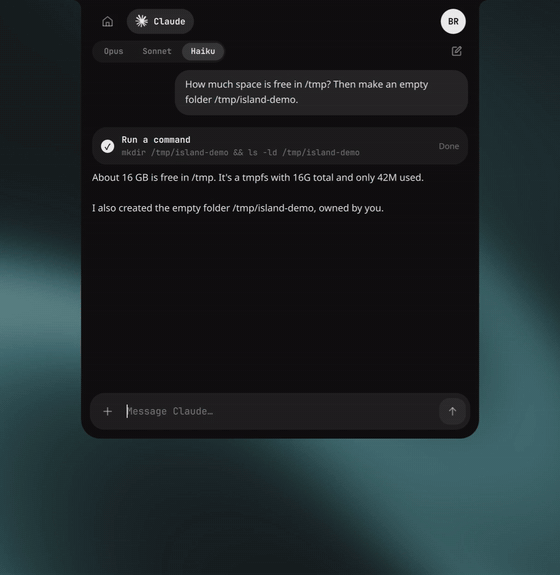
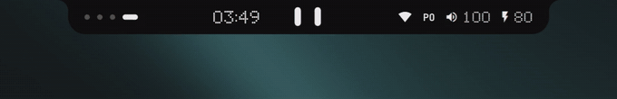
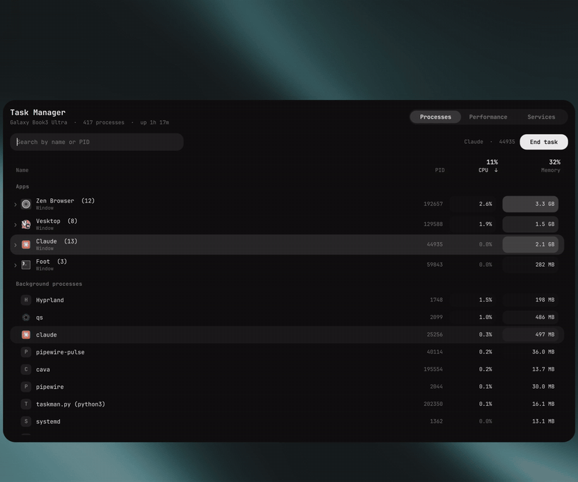
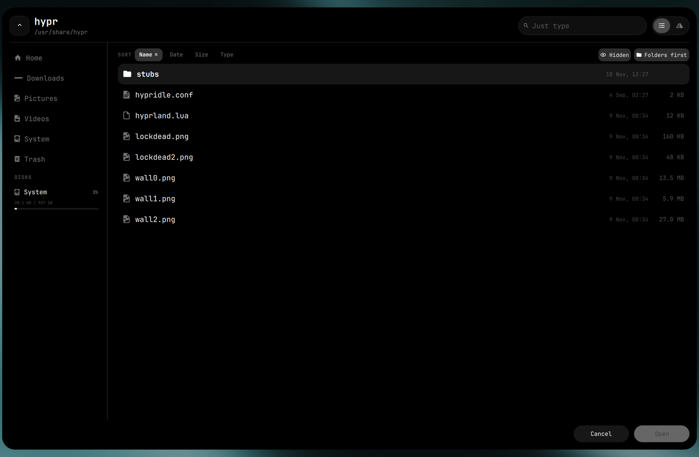

<div align="center">

# panacea-island

**A redesigned island and shell, built on top of [Panacea Shell](https://github.com/EnsixD/Panacea)**


[What it is](#what-it-is) · [Screens](#screens) · [Design kit](#the-pk-design-kit) · [Install](#install) · [How it survives updates](#how-it-survives-updates)

</div>

## What it is

Panacea puts a dynamic island at the top of the screen. This repo turns that island into the
centre of the system: one design language (black, white, greys, one red accent, JetBrains Mono,
Phosphor icons), one spring that every shape change follows, and the system's everyday tools
as island screens instead of separate windows.

It started as part of [panacea-config](https://github.com/aphesist/panacea-config) (the rest
of that machine's setup) and grew into its own thing.

## Screens

Everything below opens inside the island. The tabs on top (Home, Claude, Zen, and one naming
the page you're on) stay visible on every in-island page, so Home is always one click away.
A bell at the top right opens the notifications and shows a red dot while some are waiting;
power and settings sit beside it.

| Screen | What it does | Open it |
|---|---|---|
| **Home** | Dot-matrix clock, weather and tray icons; Wi-Fi, Bluetooth, VPN and Focus tiles; pill sliders for volume and brightness; a waveform media card; battery, recording, quick actions | click the island |
| **Notifications** | Every notification as one kind of card (app, time, title, text); Focus, Clear all | the bell, `ipc call pill notifications` |
| **Updates** | Pending repo and AUR updates (checked without root), what needs a restart, Arch news, package cache and orphans. Changes run in a terminal you see | Home, `ipc call pill updates` |
| **Logs** | The journal, newest first: levels, system or user, live, filter; ask Claude about a line | Home, `ipc call pill logs` |
| **Screen** | Screenshot an area, a window or the screen (with a delay), text from the screen (OCR), a colour picker, recording, recent shots | Home, `ipc call pill screen` |
| **Editor** | A plain-text editor that saves in place (configs reload), find, new file (+ or Ctrl+N), recent files; also an app for Open with | Home, `ipc call pill edit <path>` |
| **Startup apps** | Apps that open at login, each with a switch and a delay; the user services that start with the session | Settings, `ipc call pill startup` |
| **Open with** | Apps asking "open this with…?" get an island page (suggested apps, any app, "always use it") instead of GTK's dialog | automatic (AppChooser portal) |
| **File picker** | Every app's Open/Save dialog and the chat's paperclip morph the island into its file manager in picker mode | automatic (FileChooser portal) |
| **Task manager** | Process tree with icons and End task; this machine's hardware with live charts; services | `ipc call pill tasks` |
| **Calculator** | Type or click; the result shows live, = keeps it, click it to copy. Brackets, %, powers, history | `ipc call pill calc`, the app launcher |
| **Discord** | While you're in a Vesktop voice call: a Discord tab beside Home/Claude/Zen (mute, deafen, noise suppression, leave; everyone in the call with a ring while they talk, a volume and a mute for you per person) and a click-through overlay of who's talking in the top-right corner. Settings > Discord. Needs `--remote-debugging-port=9223` in `~/.config/vesktop-flags.conf` (local-only; `discord-bridge.mjs` reads Vencord's stores through it) | automatic, `ipc call pill discord` / `discordMute` / `discordDeafen` / `discordLeave` |
| **Battery** | Charge, health, draw, charge limit; the power mode and what it actually does (below) | Home |
| **Settings** | A new frame (search, groups, sub-pages) and every settings control redrawn with the kit | the gear |

`ipc call pill` is short for `qs -p ~/.config/panacea ipc call pill`.

`panacea-ctl` (`bin/`, installed to `~/.local/bin`) drives the desktop from one command, for you
or for the island's Claude: windows (focus, close, workspaces, open apps), typing and keys
(wtype), media players (MPRIS), volume and mic (PipeWire), Discord voice (status, mute, deafen,
leave, per-person volume), the island's IPC, notifications, and any app's buttons and fields
through AT-SPI (`a11y on` first; off by default). `panacea-ctl help` lists it all; `--json` for scripts.

The main screens are also apps in the launcher (Task Manager, Files, Text Editor, Calculator, Image Viewer,
Updates, Logs, Screen Capture, Settings), each with an icon from one family in `icons/`
(`make-icons.py` redraws them from the Phosphor font).

### Power modes that do something

TLP already sets the processor and Samsung's firmware profile (which also sets the fans: the
firmware gives no direct fan control). `panacea/scripts/custom/power-mode.sh` adds the rest
whenever the mode changes:

- **Saver** drops the internal OLED to 60 Hz (a switch on the Battery page turns that off).
- **Performance** turns on NVIDIA Dynamic Boost (`nvidia-powerd`); the other modes turn it off,
  so the GPU can sleep. This needs the polkit rule in `system/polkit/` (the installer offers it).

### Tabs that slide



### Activity glow

A thin light runs along the island's outline while something works: Claude's orange while it
thinks, white while the VPN connects, any agent's own colours
(`panacea-glow start <name> "#hex,#hex"`, or `panacea-glow run <name> "#hex" -- <command>`).
Settings → Motion → *Activity glow*.



### Task manager



### One file picker, inside the island



## The Pk design kit

`hypr/custom/ui/` holds the kit every screen is built from; [DESIGN.md](hypr/custom/ui/DESIGN.md)
is the rulebook (tokens, morphing, components, how to build a page).

- **PkTheme**: colours, radii (derived from the island's own radius), type sizes, icon fonts, motion times.
- **PkMorph**: a critically damped spring stepped every frame (it keeps its velocity when the
  target moves mid-flight). The island's width, height and every corner follow it, so a page
  change is one continuous shape, never a jump.
- Components: `PkText`, `PkIcon`, `PkCard`, `PkTile`, `PkVSlider`, `PkSlider`, `PkToggle`,
  `PkButton`, `PkIconButton`, `PkSegmented`, `PkChip`, `PkSearch`, `PkField`, `PkHeader`,
  `PkSection`, `PkRow`, `PkDotBar`, `PkRoundImage`, `PkNotifCard`.
- `ui/settings/`: Panacea's settings building blocks (`SetToggle`, `SetSlider`, `SetPick`…)
  redrawn with the kit, same API, so every settings page follows without being touched.

## Install

Panacea must already be installed.

```
git clone https://github.com/aphesist/panacea-island
cd panacea-island
bash install.sh
```

The shell reloads by itself. Optional:

- **Startup apps** run from `~/.config/panacea/scripts/custom/startup-apps.py`, once per session:
  call it from `hypr/custom/autostart.lua` inside `hl.on("hyprland.start", ...)`.
- **Task manager** shortcut: bind `qs -p ~/.config/panacea ipc call pill tasks`
  (panacea-config uses Super+Shift+Esc).
- The island chat → Claude is [panacea-claude-bridge](https://github.com/aphesist/panacea-claude-bridge).

## How it survives updates

Panacea keeps `hypr/custom/` and `panacea/scripts/custom/` across updates, and everything new
lives there. The Panacea files that must change (`shell.qml`, `FilesView.qml`, the settings
pages and their building blocks) are patched by `hypr/custom/bin/portal-patch.py`:

- it applies its changes to a saved `.pristine` copy of each file, all or nothing, and
  writes in place (Quickshell only reloads a file edited in place);
- `panacea-portal-patch.path` watches those files and re-runs it whenever an update replaces one;
- if an anchor it needs has moved, it changes nothing and says which, and Panacea keeps working
  as shipped.

To undo: `systemctl --user disable --now panacea-portal-patch.path`, then copy each
`~/.config/panacea/*.pristine` back over its file.

## Credits

Built on [Panacea Shell](https://github.com/EnsixD/Panacea) (MIT), which provides the island,
the shell around it and much of what it controls. Icons: [Phosphor](https://phosphoricons.com) (MIT).
